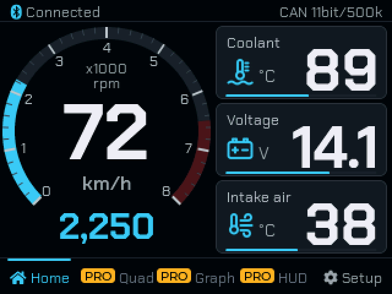

# OBD/GAUGE

**ไทย** · เปลี่ยนจอ **ESP32‑2432S028R (CYD)** เป็นเกจวัดรถยนต์ อ่านค่าผ่าน **ELM327 Bluetooth**
**English** · Turns the **ESP32‑2432S028R (CYD)** into an OBD‑II car gauge using a **Bluetooth ELM327**.

👉 **https://i3ackbazoka-dotcom.github.io/cyd-obd-gauge/** — ติดตั้งรุ่นฟรีผ่านเบราว์เซอร์ · free browser install (Chrome / Edge)

| | ฟรี · Free | PRO |
|---|:-:|:-:|
| หน้าปัดรอบ + ความเร็ว + 3 ช่อง · Tach + speed + 3 tiles | ✓ | ✓ |
| ค่าพื้นฐาน 12 อย่าง · 12 basic values | ✓ | ✓ |
| เตือนค่าผิดปกติ · อ่าน DTC · Warnings · read DTC | ✓ | ✓ |
| หรี่จออัตโนมัติ · โทนกลางคืน · Auto dim · night tone | ✓ | ✓ |
| ไทย / English · อัปเดตผ่าน Wi‑Fi · Wi‑Fi updates | ✓ | ✓ |
| หน้า 4 เกจ · กราฟ · หน้าปัด LED/เรือง/สปอร์ต · Quad · graph · LED/Glow/Sport dials | | ✓ |
| ค่าครบ 43 อย่าง · ล้าง DTC · HUD · All 43 values · clear DTC · HUD | | ✓ |

**PRO:** แอด LINE / add LINE [@675hflqu](https://line.me/R/ti/p/@675hflqu) — ส่งรหัสเครื่อง (ตั้งค่า → ปลดล็อก PRO) · send your device ID (Setup → Unlock PRO). จ่ายครั้งเดียว · one-time purchase.

---
ไฟล์ใน repo นี้สร้างอัตโนมัติ (เฟิร์มแวร์รุ่นฟรี + ตัวอัปเดต) · Files here are generated automatically (free firmware + updater) · DESIGN BY WATCHAR
